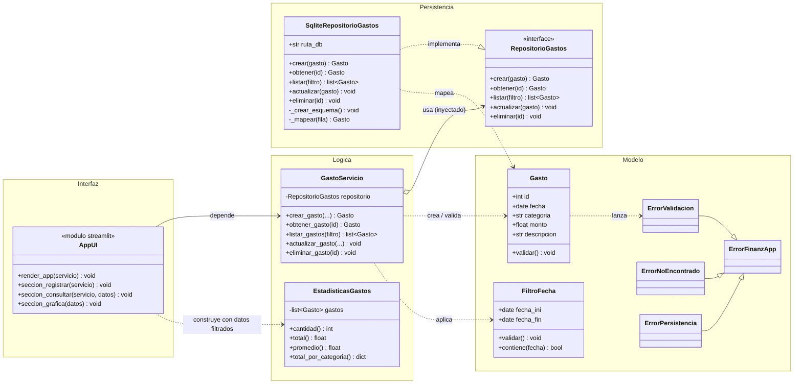
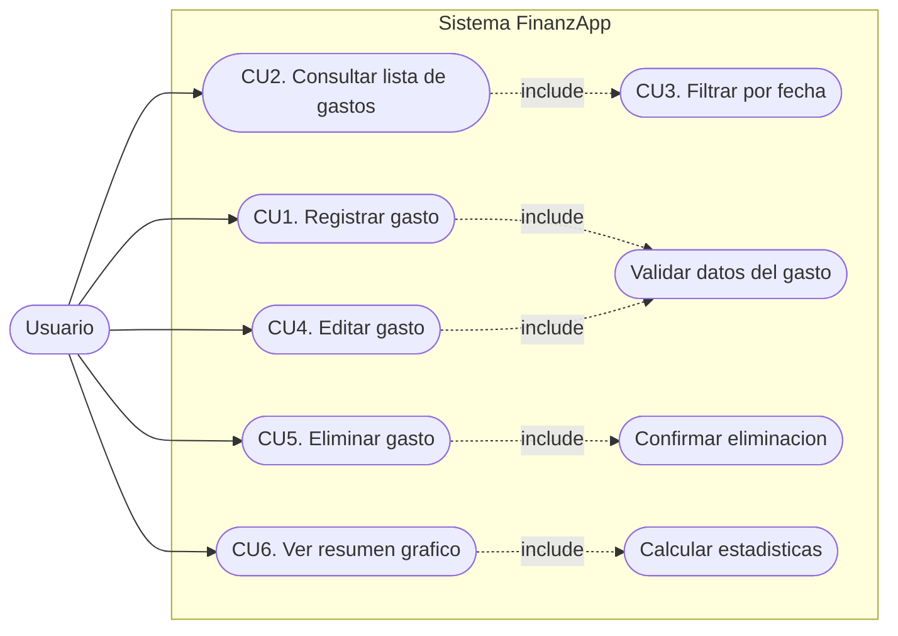

# FinanzApp

Aplicacion de escritorio web para el **control de gastos personales**, construida
100% en **Python** con interfaz en **Streamlit** y persistencia en **SQLite**
(libreria estandar, sin servicios externos).

---

## Objetivo del proyecto

Ofrecer una herramienta sencilla para registrar, consultar, editar, eliminar y
visualizar gastos personales, con validaciones claras y una arquitectura en
capas (modelo, persistencia, logica e interfaz) que sea facil de entender,
probar y mantener en un contexto academico.

## Requisitos funcionales

| # | Funcionalidad | Descripcion |
|---|---------------|-------------|
| R1 | Registrar gasto | Fecha, categoria, monto y descripcion opcional, con validaciones. |
| R2 | Consultar gastos | Tabla (ID, Fecha, Categoria, Monto, Descripcion) y filtros por fecha inicial/final. |
| R3 | Editar / Eliminar | Seleccion del gasto, edicion y eliminacion **con confirmacion previa**. |
| R4 | Grafica | Gasto agrupado por categoria, calculado **sobre los mismos datos filtrados** de la tabla. |

---

## Requisitos del entorno

- **Python 3.10 o superior** (probado con Python 3.14).
- `streamlit`, `pandas` y `pytest` (ver `requirements.txt`).
- No requiere servidores ni bases de datos externas.

## Instalacion

```bash
# 1. (Opcional) crear y activar un entorno virtual
python -m venv .venv
# Windows:
.venv\Scripts\activate
# Linux/macOS:
source .venv/bin/activate

# 2. Instalar dependencias
python -m pip install -r requirements.txt
```

> Si `pip` no estuviera disponible, ejecuta primero `python -m ensurepip --upgrade`.

## Ejecucion

```bash
streamlit run app.py
```

Streamlit abrira la aplicacion en el navegador (por defecto
`http://localhost:8501`). La base de datos `data/finanzapp.db` y su tabla se
crean **automaticamente** en el primer arranque.

## Estructura del proyecto

```
FinanzApp/
├── app.py                          # Punto de entrada (streamlit run app.py)
├── requirements.txt
├── pytest.ini
├── README.md
├── data/                           # Base de datos SQLite (se crea en runtime)
│   └── .gitkeep
├── src/
│   ├── modelos/                    # Capa de MODELO (datos + reglas basicas)
│   │   ├── gasto.py                # Entidad Gasto + catalogo de categorias
│   │   ├── filtro.py               # Objeto de valor FiltroFecha
│   │   └── errores.py              # Excepciones de dominio
│   ├── persistencia/               # Capa de PERSISTENCIA (SQLite)
│   │   ├── repositorio.py          # Interfaz RepositorioGastos (ABC)
│   │   └── sqlite_repositorio.py   # Implementacion con sqlite3
│   ├── logica/                     # Capa de LOGICA de negocio
│   │   ├── gasto_servicio.py       # Casos de uso (crear/listar/editar/eliminar)
│   │   └── estadisticas.py         # EstadisticasGastos (calculos para la grafica)
│   └── ui/                         # Capa de INTERFAZ (Streamlit)
│       ├── componentes.py          # Formularios, tabla, filtros y grafica
│       └── paginas.py              # Orquestacion de la pagina
└── tests/                          # Pruebas automaticas (pytest + AppTest)
    ├── conftest.py
    ├── test_modelo.py
    ├── test_servicio.py
    ├── test_repositorio.py
    ├── test_estadisticas.py
    └── test_ui.py
```

---

## Uso de la aplicacion

La interfaz tiene tres pestanas y una barra lateral de filtros.

### 1. Registrar gasto (R1)
Completa **Fecha**, **Categoria** (lista predefinida), **Monto** y
**Descripcion** (opcional) y pulsa *Guardar gasto*.
Se valida que el monto sea numerico y mayor que cero, que la categoria sea
valida y que la fecha exista.

### 2. Consultar / Editar / Eliminar (R2 y R3)
- La tabla muestra los gastos que cumplen los filtros.
- Usa los filtros de **fecha inicial** y **fecha final** de la barra lateral
  (dejalos vacios para ver todos). Los limites son **inclusivos**.
- **Editar**: selecciona un gasto en *Editar gasto*, modifica los campos y
  pulsa *Guardar cambios*.
- **Eliminar**: selecciona un gasto, pulsa *Solicitar eliminacion* y confirma
  con *Confirmar eliminacion* (o cancela).

### 3. Grafica (R4)
Muestra el **gasto total**, el **numero de gastos**, el **promedio** y una
grafica de barras de **gasto por categoria**. La grafica se calcula siempre
sobre **exactamente los mismos gastos filtrados** que aparecen en la tabla, por
lo que se actualiza automaticamente al cambiar los filtros.

---

## Arquitectura

Diseno en cuatro capas con dependencias dirigidas hacia el interior, de modo que
la interfaz no conoce SQLite y la persistencia no conoce Streamlit.

- **Modelo** (`src/modelos`): entidades y validaciones. Sin I/O.
- **Persistencia** (`src/persistencia`): unica capa que usa `sqlite3`.
- **Logica** (`src/logica`): reglas de negocio, filtros y estadisticas.
- **Interfaz** (`src/ui`): widgets Streamlit.

### Diagrama de clases



### Diagrama de casos de uso



---

## Pruebas

```bash
python -m pytest
```

Cubren como minimo:

- **Creacion** de un gasto y asignacion de id.
- **Consulta** (obtener/listar).
- **Filtrado** por rango de fechas (inclusivo) y validacion de fechas invertidas.
- **Edicion** de un gasto existente y error al editar un id inexistente.
- **Eliminacion** y confirmacion previa en la interfaz.
- **Calculo de estadisticas** (total, promedio y total por categoria).
- **Interfaz** con `streamlit.testing.v1.AppTest` (registro, filtro y grafica
  coherentes, eliminacion con confirmacion).

---

## Tecnologias utilizadas

- **Python 3** - lenguaje unico del proyecto.
- **Streamlit** - interfaz web.
- **SQLite** (`sqlite3`, libreria estandar) - persistencia local.
- **pandas** - construccion de la tabla y de la grafica.
- **pytest** + **AppTest** - pruebas de logica y de interfaz.

---

## Notas y solucion de problemas

- **Base de datos**: por defecto en `data/finanzapp.db`. Puedes indicar otra
  ruta con la variable de entorno `FINANZAPP_DB`.
- **Borrar todos los datos**: elimina el archivo `data/finanzapp.db`; se
  recreara vacio en el siguiente arranque.
- **`ModuleNotFoundError: typing_extensions`**: ejecuta
  `python -m pip install -r requirements.txt` (o reinstala Streamlit).
- **Fechas invertidas**: la aplicacion avisa y no aplica el filtro.
